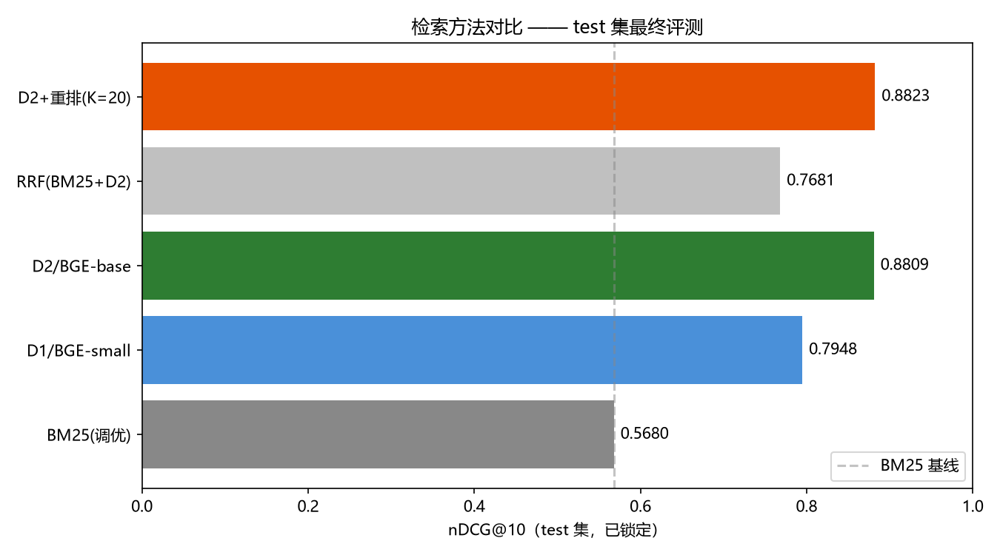
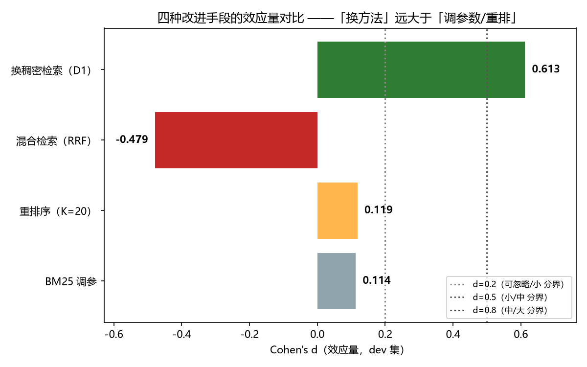
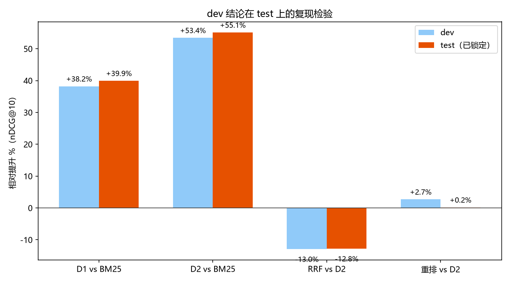
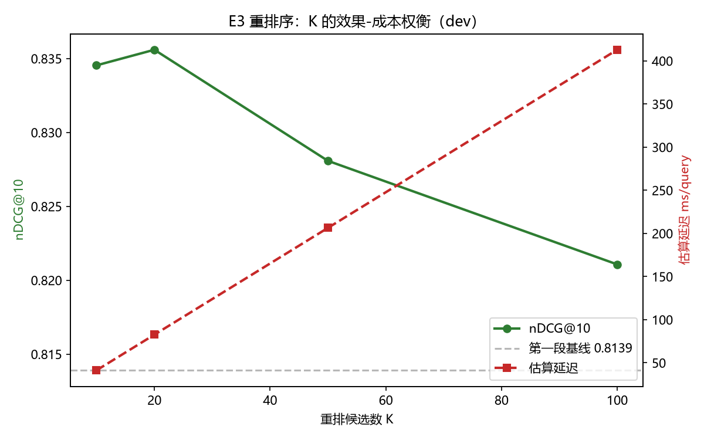
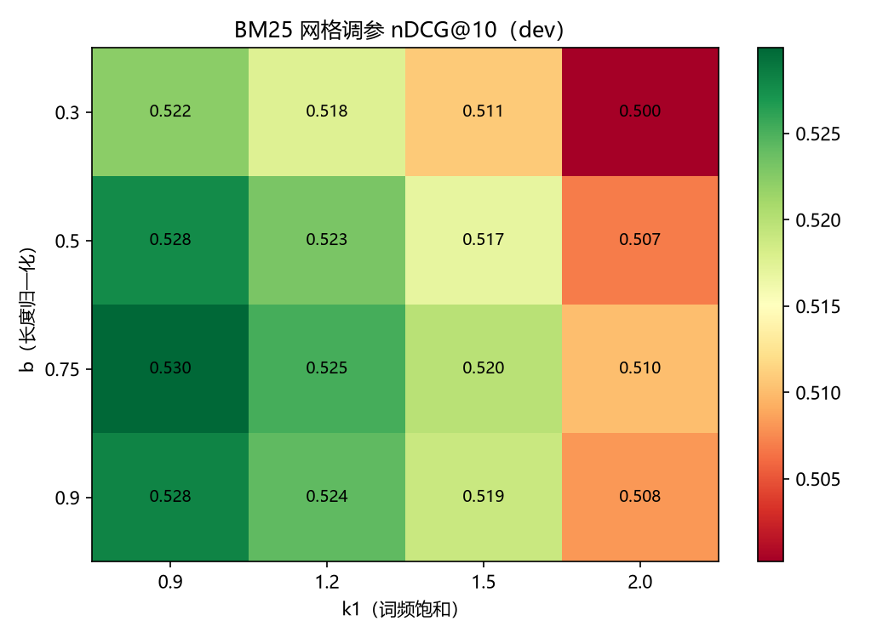

# RAG-Retrieval-Lab · 中文检索增强生成实验台

> 本项目的目标是量化检索各环节的真实贡献——回答"哪一层带来多少增益"，而非仅演示一个可运行的流程。

---

## 项目概述

这是一个可复现的中文检索实验台，系统对比以下四个问题：

| 实验 | 问题 | 主指标 |
|---|---|---|
| E1 | 稠密向量检索相比 BM25 有多少提升？ | Recall@10, nDCG@10 |
| E2 | 混合检索（RRF）是否带来提升？ | nDCG@10 |
| E3 | 重排序是否值得其额外成本？ | nDCG@10 + 延迟 |
| E4 | 文档分块策略如何影响检索？ | Recall@10 |

数据集为百度 [DuReader-retrieval](https://aclanthology.org/2022.emnlp-main.357/)（97K queries / 890 万段落）。

---

## 项目背景

| 依据 | 来源 |
|---|---|
| AI 应用开发工程师需求占比 53.9%（最集中） | 前程无忧《2027 届校招 AI 人才市场洞察》 |
| 企业岗位普遍要求 RAG、Memory、Tool Use 的工程化落地 | 阿里巴巴 27 届算法岗招聘说明 |
| 企业最看重数学与统计基础（58.9%） | 前程无忧，同上 |

本项目与课程知识的对应关系：

- 召回 + 排序两阶段 → Course 3 第 123 页
- 双塔 / 双编码器 → Course 3 第 122 页
- 评测方法论（精确率 / 召回率 / 偏斜数据）→ Course 2 第 86–87 页、Course 3 第 111 页

---

## 快速开始

### 第 1 步：检查环境

```bash
python scripts/check_env.py
```

脚本会直接输出下一步应执行的命令。

### 第 2 步：安装最小依赖（纯 CPU，先跑通 BM25）

```bash
pip install requests tqdm PyYAML jieba rank-bm25
```

分阶段安装的目的：先用 BM25 验证评测代码的正确性，并对照文献确认指标实现无误，再引入向量检索依赖。这样即使后续 GPU 环境出现问题，也已有可用的产出。

### 第 3 步：安装向量检索依赖

```bash
pip install numpy pandas scipy matplotlib
pip install torch --index-url https://download.pytorch.org/whl/cpu  # 或 cu121
pip install transformers sentence-transformers faiss-cpu datasets
```

Windows 下若 `faiss-cpu` 安装失败，见 [`docs/08-环境与技术栈.md`](docs/08-环境与技术栈.md) 第三节的三个备选方案。

### 第 4 步：下载数据

```bash
python scripts/download_data.py
```

### 第 5 步：运行实验

```bash
python -m src.pipeline.run_experiment --config configs/e1_baseline.yaml
```

---

## 目录结构

```
RAG-Retrieval-Lab/
├── docs/           # 19 份文档（先读 05 和 06；结论见 17）
├── configs/        # YAML 配置，修改参数即可复现
├── data/           # 数据（不入版本库）
├── src/
│   ├── data/       # 下载、清洗、分块
│   ├── retrieval/  # BM25 / 稠密 / 混合融合
│   ├── rerank/     # Cross-encoder 重排序
│   ├── eval/       # 指标计算（含单元测试）
│   └── pipeline/   # 实验编排
├── scripts/        # check_env.py / download_data.py 等
├── tests/          # 单元测试
└── results/        # 实验结果（入版本库）
```

---

## 必读文档（按顺序）

| 顺序 | 文档 | 说明 |
|---|---|---|
| 1 | [`docs/05-评测协议.md`](docs/05-评测协议.md) | 最重要：指标计算错误会使所有结论失效 |
| 2 | [`docs/06-实验设计.md`](docs/06-实验设计.md) | E1–E4 的完整方案 |
| 3 | [`docs/01-项目章程.md`](docs/01-项目章程.md) | 目标、范围边界、成功标准 |
| 4 | [`docs/04-数据集规范.md`](docs/04-数据集规范.md) | 数据格式与分阶段策略 |
| 5 | [`docs/03-技术方案设计.md`](docs/03-技术方案设计.md) | 架构与选型理由 |
| 6 | [`docs/08-环境与技术栈.md`](docs/08-环境与技术栈.md) | 环境问题与应对 |
| 7 | [`docs/07-风险与局限声明.md`](docs/07-风险与局限声明.md) | 结论的有效边界 |
| 8 | [`docs/09-实施计划.md`](docs/09-实施计划.md) | 里程碑与降级策略 |
| 9 | [`docs/02-需求规格说明书.md`](docs/02-需求规格说明书.md) | 功能与非功能需求 |

---

## 实验纪律

本项目全程遵循五条原则：

1. 一次只改一个变量，否则无法归因
2. 测试集只用一次，调参一律在 dev 集
3. 必须报告基线（BM25），否则"提升"无从谈起
4. 必须报告成本，"提升 2% 但慢 10 倍"同样是有价值的结论
5. 提升必须通过显著性检验，不把噪声当作提升

---

## 硬件要求

| 项 | 最低 | 推荐 | 本机实测 |
|---|---|---|---|
| 内存 | 16 GB | 32 GB | 31.7 GB |
| 显存 | 不需要（CPU 可跑） | 8 GB | RTX 4060 8GB |
| 磁盘 | 50 GB | 100 GB | 695 GB |

无独立显卡也能完成全部实验（CPU 慢 3–5 倍）。

---

## 局限声明（摘要）

| 局限 | 说明 |
|---|---|
| 规模 | 主实验使用 10 万–100 万段落，生产级为千万以上 |
| 领域 | 数据集来自通用网页搜索，不适用于垂直领域 |
| 范围 | 评测的是检索质量，不是端到端 RAG 效果 |
| 方法 | 未覆盖多向量检索、领域微调、检索-生成联合优化 |

完整声明见 [`docs/07-风险与局限声明.md`](docs/07-风险与局限声明.md)。

---

## 引用

```bibtex
@inproceedings{qiu2022dureader,
  title={DuReader-Retrieval: A Large-scale Chinese Benchmark for Passage Retrieval from Web Search Engine},
  author={Qiu, Yifu and others},
  booktitle={EMNLP},
  year={2022}
}
```

模型：`BAAI/bge-small-zh-v1.5`、`BAAI/bge-reranker-base`

---

## 项目状态

项目已完成（M0–M6 全部达成）：

| 阶段 | 状态 | 说明 |
|---|---|---|
| M0 环境搭建 + 文档 | 完成 | venv 验证 34/34 |
| M1 数据准备 | 完成 | dev 8,640 / test 2,000 query；见 [DATACARD](data/DATACARD.md) |
| M1.5 指标实现验证 | 完成 | 单测 139/139；oracle/random/anti 交叉验证 |
| M2 E1 基线 | 完成 | 稠密显著优于 BM25（test +55.1%）；见 [docs/11](docs/11-E1实验报告草稿.md) |
| M3 E2 混合检索 | 完成 | 负面结果：RRF 比纯 D2 差 -12.8%；见 [docs/13](docs/13-E2混合检索实验报告.md) |
| M4 E3 重排序 | 完成 | K=20 为甜点；dev +2.67%；见 [docs/14](docs/14-E3重排序实验报告.md) |
| M4.5 test 最终评测 | 完成 | 已锁定；三个结论复现两个、反转一个；见 [docs/15](docs/15-test最终评测报告.md) |
| M5 E4 分块消融 | 完成 | 负面结果：分块全面劣于不切分；见 [docs/16](docs/16-E4分块消融实验报告.md) |
| M6 实验报告 + 复盘 | 完成 | [最终报告](docs/17-最终实验报告.md) ｜ [复盘](docs/09-实施计划.md) |
| 封版（2026-10-31） | 完成 | 文档状态核对；补测分块深度扫描与重排 K=200；成本口径修正 |

## 最终结论（test 集，已锁定）

| 方法 | nDCG@10 | vs BM25 |
|---|---|---|
| BM25（调优） | 0.5680 | — |
| D1 / BGE-small | 0.7948 | +39.9% |
| D2 / BGE-base | 0.8809 | +55.1%（d=1.035，大效应） |
| RRF（BM25+D2） | 0.7681 | +35.2% |
| D2+重排（K=20） | 0.8823 | +55.3% |

四个核心发现：

1. 更换检索范式的收益远大于排序优化：换稠密（d=1.035）是调参（d=0.114）的约 9 倍
2. 混合检索在质量悬殊时是负优化（-12.8%，test 复现）；最优权重是"不混合"
3. 重排收益取决于第一段强度：弱段（BM25）+22.9%（K=20）至 +37.6%（K=200）；强段（test D2，nDCG@10=0.88）不显著（+0.16%，p=0.625），原因在于天花板效应而非方法失效
4. 分块全面劣于不切分（-0.33%~-2.58%），块越小越差；深度扫描（K 10→100）已排除"评测口径造成假象"的可能

> 一句话总结：先选对检索范式，其余优化多为边际收益。

## 图表

| 图 | 内容 |
|---|---|
|  | test 集各方法对比 |
|  | 四种手段效应量对比 |
|  | dev → test 泛化检验 |
|  | E3 重排的 K 效果-成本 |
|  | BM25 网格调参热力图 |

### 数据划分说明

本项目的 dev 与 test 来自不同来源，绝对指标不可跨集比较：

| 集合 | 来源 | query 数 | 每 query 平均相关数 |
|---|---|---|---|
| dev | `zyznull/dureader-retrieval-ranking` train 切片 | 8,640 | 2.60 |
| test | `C-MTEB/DuRetrieval` 官方测试集 | 2,000 | 4.92 |

原因：官方 `dev.jsonl.gz` 经逐条比对实为测试集（与 C-MTEB 2,000 query 文本交集 100%），直接使用等同于在测试集上调参。详见 [data/DATACARD.md](data/DATACARD.md) 第四节问题 6。

---

## 许可与用途

本项目为学习性实验，仅用于学术研究。数据集与模型的使用须遵守其原始许可条款。
